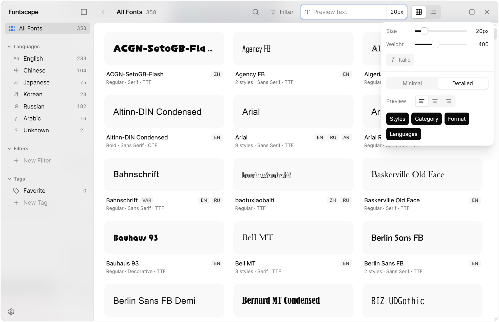

# Fontscape

[中文文档](./README_CN.md)

Modern font browsing / management tool for Windows built with Tauri and React.

> This project is still under development, but browsing and filtering already work well enough for daily use, so I put it here.

## Screenshots



## Download

Download the latest Windows installer from [GitHub Releases](https://github.com/Sansui233/Fontscape/releases/latest).

Requires Windows 10/11.

## Why do this?

- It can accurately filter fonts by language, and basically supports the languages ​​of the three East Asian countries that are planned to be improved.
- Able to view the corresponding CSS variable names

Windows' built-in font software is practically useless for language filtering. As a Chinese user, I really wanted a font browser that could truly filter Chinese fonts. That's why this project came about.

In addition, the font metadata on the internet is rather messy; for example, the CSS font-family of some Simplified Chinese fonts is Traditional Chinese name, etc. Therefore, we use the parsing priority of the browser to obtain the available CSS font-family name.

## Features

- **Browse**: grid and list views with virtual scrolling, live preview text and size, missing glyphs shown as □
- **Filter**: by language, category (serif / sans / mono / handwriting / decorative), name and tag
- **Saved filters**: save conditions as named filters, organize them in nested folders, drag to reorder
- **Tags**: tag font families from the card / list context menu, multi-select mode or the detail page
- **Detail page**: all styles of a family, multi-script previews, name table metadata
- **Localized names**: shows Chinese / Japanese / Korean font names following the interface language
- **Interface**: English, 简体中文, 日本語, 한국어; light / dark / system appearance
- **Persistence**: filters, tags, settings and the last UI state are stored in a local SQLite database

## TODO

- [ ] Fast startup (incremental font cache)
- [ ] Pinyin search for Chinese fonts
- [ ] Paper view
- [ ] Batch operations in multi-select mode
- [ ] Install / Uninstall / Toggle fonts
- [ ] Download from open source
- [ ] Export font samples

---

## Development

### Tech Stack

#### Frontend
- React 19 + TypeScript
- Tailwind CSS 4
- Zustand (state management)
- TanStack Virtual (virtualization)
- React Router 7
- Vite

#### Backend
- Tauri 2
- Rust
- ttf-parser (font parsing)
- rusqlite (local storage)
- Windows API bindings

### Getting Started

#### Prerequisites
- Node.js 18+ and pnpm
- Rust 1.70+
- Windows 10/11

#### Installation

1. Clone the repository:
```bash
git clone https://github.com/Sansui233/Fontscape.git
cd Fontscape
```

2. Install dependencies:
```bash
pnpm install
```

3. Run in development mode:
```bash
pnpm tauri:dev
```

4. Build for production:
```bash
pnpm tauri:build
```

### Release

The version lives only in `package.json` (`tauri.conf.json` reads it; `npm version` syncs `Cargo.toml` / `Cargo.lock`). Bump, commit and tag in one step, then push the tag to trigger the GitHub release build:

```bash
npm version minor   # or patch / major / 1.2.3
git push --follow-tags
```

The release workflow fails if the tag does not match the `package.json` version.

### Project Structure

```
fontscape/
├── src/                    # React frontend
│   ├── components/         # UI components (layout, font, filter, tags, settings)
│   ├── pages/              # Grid, list and family detail pages
│   ├── store/              # Zustand stores
│   ├── i18n/               # Interface translations
│   └── lib/                # Utilities and Tauri API wrappers
├── src-tauri/              # Rust backend
│   └── src/
│       ├── font/           # Font scanning, parsing and classification
│       ├── filters/        # Saved filters and folders
│       ├── tags/           # Font family tags
│       ├── settings/       # UI state and preferences
│       ├── persistence/    # SQLite database and migrations
│       └── commands.rs     # Tauri commands
└── docs/                   # Design notes and feature status
```

### Development Roadmap

- [x] Phase 1: Basic framework setup
- [x] Phase 2: Font scanning and parsing
- [x] Phase 3: Font preview
- [x] Phase 4: Search functionality
- [ ] Phase 5: Font management (enable/disable)
- [x] Phase 6: Categorization and filtering
- [x] Phase 7: Font detail page
- [ ] Phase 8: Performance optimization
- [ ] Phase 9: Polish and release

### Contributing

Contributions are welcome! Please feel free to submit a Pull Request.

## License

GNU3.0

## Author

Sansui233
